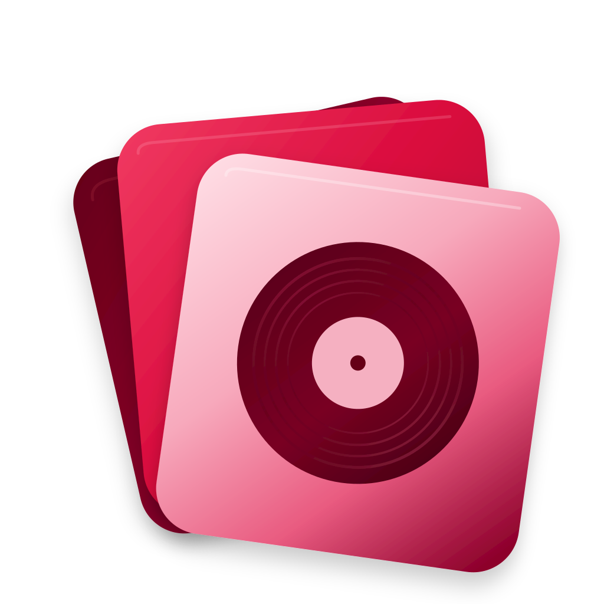

  

<h1 align="center">Wedone SetScrobble</h1>

  <strong>Scrobble tes concerts, films, vinyles et albums sur Last.fm, sans rien installer.</strong> 
  Une application web gratuite et sans serveur, qui tourne entièrement dans ton navigateur.

  
  
  
  

---

## Pourquoi SetScrobble ?

Tu as écouté un album en vinyle, vu un concert ou regardé un film dont la bande originale t'a marqué, et ton compte [Last.fm](https://www.last.fm) n'en garde aucune trace ? **SetScrobble** te permet d'ajouter ces écoutes après coup, avec les bons horaires, pour que ton historique reflète vraiment ce que tu as écouté.

L'application est accessible depuis le lien du dépôt (colonne *About*, à droite) : ouvre-la, connecte ton compte Last.fm, et c'est parti.

## Fonctionnalités

| Module | À quoi ça sert |
| --- | --- |
| **Scrobble rapide** | Ajoute des morceaux à une file avec autocomplétion Last.fm, puis envoie-les d'un coup. L'onglet *Récents Last.fm* affiche tes derniers scrobbles avec leur pochette, et permet de les rejouer ou de les remettre en file. |
| **Setlists** | Crée, modifie, duplique et supprime tes setlists (concerts, films, vinyles, CD ou listes libres). Import et export au format JSON. |
| **Éditeur** | Horodatage automatique (heure de début + intervalle), sélection multiple, scrobble morceau par morceau ou en bloc, import depuis setlist.fm. |
| **Albums** | Recherche un album, calcule les horaires à partir des durées réelles des titres (ou d'un intervalle fixe), puis scrobble-le en entier ou ouvre-le dans l'éditeur. |
| **Paramètres** | Guide de connexion Last.fm pas à pas, profil, clé setlist.fm et déconnexion. |

L'interface propose les thèmes **Système, Clair et Sombre**, s'adapte aux mobiles, et se sauvegarde au fil de l'eau : `Ctrl/⌘ + S` enregistre la setlist en cours, `Échap` ferme les fenêtres.

## Prise en main

À la première ouverture, SetScrobble t'amène directement dans les **Paramètres** : les modules restent verrouillés tant que Last.fm n'est pas connecté. Un guide en quatre étapes t'accompagne :

1. **Crée une application Last.fm** sur [last.fm/api/accounts](https://www.last.fm/api/accounts) (c'est gratuit). Le champ *Callback URL* n'est pas utilisé par SetScrobble.
2. **Renseigne ta clé API et ton secret**, puis enregistre-les.
3. **Autorise Wedone** : Last.fm s'ouvre dans un nouvel onglet, accepte l'accès demandé.
4. **Valide la connexion** avec le bouton *« J'ai autorisé Last.fm »*. Tu arrives sur **Scrobble rapide**.

> **Facultatif :** une clé gratuite [setlist.fm](https://www.setlist.fm/settings/api), à ajouter dans les Paramètres, permet d'importer les setlists de concerts réels.

## Historique des versions

Les versions de Wedone SetScrobble sont répertoriées ci-dessous, de la plus récente à la plus ancienne. Chaque version possède sa propre fiche afin de distinguer clairement les fonctionnalités, nouveautés et corrections qui lui appartiennent.

---

<strong>Version 1.0.0</strong> - Samedi 31 octobre 2026

 

> <strong>Publication initiale</strong>
>
> Cette première version officielle de Wedone SetScrobble introduit les fonctionnalités principales de l'application.

### Fonctionnalités

- **Scrobble rapide :** recherche de morceaux avec autocomplétion Last.fm, mise en file d'attente et envoi groupé des écoutes. Consultation des scrobbles récents avec leur pochette, possibilité de les rejouer ou de les remettre en file.
- **Setlists :** création, modification, duplication et suppression de listes personnalisées. Gestion des concerts, films, vinyles, CD et listes libres, avec import et export JSON.
- **Éditeur :** génération automatique des horaires de scrobbling, sélection multiple, envoi individuel ou groupé des morceaux et import depuis setlist.fm.
- **Albums :** recherche d'albums, calcul automatique des horaires à partir des durées réelles des titres ou d'un intervalle fixe, puis scrobbling complet ou transfert vers l'éditeur.
- **Paramètres et connexion :** guide de configuration Last.fm en quatre étapes, gestion du profil, configuration de la clé API setlist.fm et déconnexion.
- **Personnalisation :** thèmes Système, Clair et Sombre, interface adaptative pour ordinateurs et mobiles.
- **Sauvegarde locale :** conservation automatique des paramètres et des données dans le navigateur, avec raccourcis clavier.

### Infrastructure et confidentialité

- Application entièrement exécutée côté navigateur, sans serveur Wedone.
- Aucune installation ni étape de compilation nécessaire.
- Stockage local des paramètres, clés API et setlists.
- Communication directe avec Last.fm et setlist.fm selon les fonctionnalités utilisées.

---

## Historique des versions

### Version 1.0.0 - Samedi 31 octobre 2026

Cette première version officielle de Wedone SetScrobble introduit les fonctionnalités principales de l'application.

**Fonctionnalités disponibles :**

- **Scrobble rapide :** recherche de morceaux avec autocomplétion Last.fm, mise en file d'attente et envoi groupé des écoutes. Consultation des scrobbles récents, avec possibilité de les rejouer ou de les ajouter à la file.
- **Setlists :** création, modification, duplication et suppression de listes personnalisées. Gestion des concerts, films, vinyles, CD et listes libres, avec import et export JSON.
- **Éditeur :** génération automatique des horaires de scrobbling, sélection multiple, envoi individuel ou groupé des morceaux et import de setlists depuis setlist.fm.
- **Albums :** recherche d'albums, calcul automatique des horaires à partir des durées réelles des morceaux ou d'un intervalle fixe, et envoi complet ou transfert vers l'éditeur.
- **Paramètres et connexion :** guide de configuration Last.fm en quatre étapes, gestion du profil, configuration de la clé API setlist.fm et déconnexion.
- **Personnalisation :** thèmes Système, Clair et Sombre, interface adaptative pour ordinateurs et mobiles.
- **Sauvegarde locale :** conservation automatique des paramètres et des données dans le navigateur, avec raccourcis clavier pour faciliter l'utilisation.

**Infrastructure et confidentialité :**

- Application entièrement côté navigateur, sans serveur Wedone.
- Aucune installation ni étape de compilation nécessaire.
- Stockage local des paramètres, clés et setlists.
- Communication directe avec les services Last.fm et setlist.fm selon les fonctionnalités utilisées.

## Confidentialité et sécurité

- **Aucun serveur Wedone** : tes données ne sont envoyées qu'à Last.fm (et à setlist.fm si tu l'utilises).
- Tes réglages, tes clés et tes setlists sont enregistrés dans le **stockage local de ton navigateur**. Ils restent sur ton appareil et ne sont pas synchronisés ; vider les données du site les efface. Pense à **exporter tes setlists en JSON** pour en garder une copie.
- Les opérations signées de Last.fm exigent ton **API Secret** côté navigateur : il n'est donc pas protégé par un serveur privé. Ne le partage avec personne, évite les appareils partagés et clique sur *Déconnecter* après usage.

## Héberger ta propre copie

SetScrobble est un simple fichier `index.html` (avec son dossier `assets`), sans framework ni étape de build. Pour en avoir ta propre version : fais un *fork* du dépôt, puis active **GitHub Pages** dans *Settings → Pages* (branche `main`, dossier `/ (root)`).

---

  Wedone SetScrobble · fait pour les mélomanes qui aiment garder une trace.

